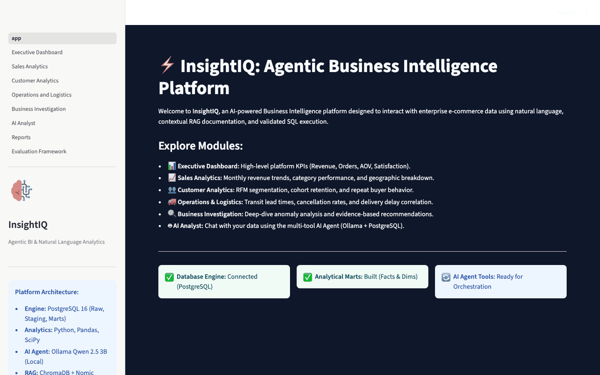

# ⚡ InsightIQ: Agentic Business Intelligence Platform

> **An enterprise-grade, local-first AI Business Intelligence platform powered by Multi-Tool Agent Orchestration, RAG Knowledge Retrieval, and Natural Language to SQL on the 100k-Order Olist Brazilian E-Commerce Dataset.**

[](https://www.python.org/downloads/)
[](https://www.postgresql.org/)
[](https://fastapi.tiangolo.com/)
[](https://streamlit.io/)
[](https://ollama.com/)
[](https://www.trychroma.com/)
[](https://www.langchain.com/)
[]()
[]()
[](LICENSE)

---

## 📌 Executive Summary

Modern enterprise analytics often suffers from a trade-off: traditional BI dashboards are rigid and slow to adapt to ad-hoc business inquiries, while naive generative AI chatbots frequently hallucinate numbers, risk destructive SQL execution, and lack domain grounding.

**InsightIQ** bridges this gap. It provides an autonomous, multi-tool agentic architecture that translates natural language inquiries into safe, validated PostgreSQL queries against a dimensional star schema, semantically retrieves organizational definitions and metric documentation via ChromaDB RAG, and conducts deep-dive business investigations with mathematical rigor.

**100% Local & Cost-Free:** All core intelligence runs on local hardware using Ollama (`qwen2.5:3b` + `nomic-embed-text`) and PostgreSQL 16—zero dependence on paid proprietary cloud APIs.

👉 **[View the Complete Visual Walkthrough & AI Integration Guide](docs/DEMO_GUIDE.md)** for detailed feature tours, architectural diagrams, full-page screenshots, and video recordings.

---

## 🎬 Visual Walkthrough Preview


*Full HD Walkthrough Video available at [`docs/assets/videos/insightiq_walkthrough.webm`](docs/assets/videos/insightiq_walkthrough.webm).*

---

## 🏛️ System Architecture

InsightIQ is engineered with clean layer decoupling across presentation, routing, multi-tool reasoning, and storage:

```
+-----------------------------------------------------------------------------+
|                          Streamlit Presentation Layer                       |
|   (Executive KPIs | Sales | Customers | Logistics | AI Analyst | Reports)   |
+--------------------------------------+--------------------------------------+
                                       | REST API (HTTP)
+--------------------------------------v--------------------------------------+
|                           FastAPI Gateway Layer                             |
|      - Pydantic v2 Contract Validation & Error Interception                 |
|      - Healthcheck Telemetry & Swagger/OpenAPI Interactive Docs             |
+--------------------------------------+--------------------------------------+
                                       |
+--------------------------------------v--------------------------------------+
|                     Orchestration & Reasoning Layer                         |
|   +-----------------------+ +--------------------+ +--------------------+   |
|   | AgentIntentClassifier | |  OrchestratorAgent | |  ToolRegistry      |   |
|   +-----------------------+ +--------------------+ +--------------------+   |
+--------------------+-------------------+--------------------+---------------+
                     |                   |                    |
        +------------v----+       +------v-----+       +------v------+
        | SQLAnalyticsTool|       |RAGRetrieval|       | PythonTool  |
        | - AST Validator |       | - ChromaDB |       | - Pandas    |
        | - Reflection    |       | - Nomic    |       | - SciPy/RFM |
        +------------+----+       +------+-----+       +------+------+
                     |                   |                    |
+--------------------v-------------------v--------------------v---------------+
|                           Storage & AI Infrastructure                       |
|   PostgreSQL 16 (Port 5433)      ChromaDB (Local)        Ollama (Port 11434)|
|   - raw (source tables)          - Vector collection     - qwen2.5:3b       |
|   - staging (cleaned)            - 27 document chunks    - nomic-embed-text |
|   - analytics (star schema)      - Cosine similarity     - Keep-alive 24h   |
+-----------------------------------------------------------------------------+
```

---

## 🔍 Key Business Findings & Analytical Baselines

Grounded across **99,441 orders** and **1,550,922 ingested records** from the Brazilian E-Commerce dataset:

| Business Dimension | Verified Baseline Metric | Strategic Business Implication |
| :--- | :--- | :--- |
| **Delivered Revenue** | **R$ 15,424,463.65** (96,478 delivered orders) | Net realized revenue (Item GMV: R$ 13.22M + Freight: R$ 2.20M). |
| **Customer Grain** | **96,096 distinct people** (`customer_unique_id`) | While `customer_id` is an order token (99.4k), only 96.1k unique buyers exist. |
| **Repeat Purchase Rate** | **3.12%** (2,997 repeat buyers) | Marketplace exhibits extreme one-off purchase behavior; urgent need for re-engagement. |
| **Average Order Value** | **R$ 159.88** per delivered order | Base transaction value excluding multi-slice payment inflation. |
| **Delivery Lead Time** | **12.5 days** mean delivery window | On-time delivery rate stands at 91.89% across all 27 Brazilian states. |
| **The 3-Day Delay Cliff** | **4.29 ★** (On-Time) $\rightarrow$ **2.60 ★** (3-5 Days Late) | Critical SLA threshold: at $\ge 3$ days late, 1-star reviews surge 7.02x (45.1%). |
| **Peak Historical Spike** | **2017-11-24:** R$ 175,320.05 (1,147 orders) | Black Friday 2017 represented an extreme statistical outlier ($Z = 10.44$). |

---

## ⚡ v1.1 Advanced Agentic Capabilities

InsightIQ v1.1 expands the autonomous analyst with cutting-edge conversational ergonomics:

1. **🧠 Conversational Multi-Turn Memory (`ConversationalMemoryManager`):**
   - Retains sliding-window dialogue turns with session isolation.
   - Coreference resolution rewrites follow-up questions (e.g. *"Filter that down to São Paulo"*, *"What about health and beauty?"*) using preceding turn SQL context and entity parameters.
2. **🌊 Real-Time Token Streaming (Server-Sent Events & Typewriter UI):**
   - Exposes `POST /api/agent/stream` yielding immediate tool step traces and incremental word tokens.
   - Live `st.write_stream` typewriter rendering delivers snappy visual feedback as the agent formulates conclusions.
3. **📑 Boardroom Executive PDF Briefing Engine (`PDFReportGenerator`):**
   - High-fidelity PDF document generation using pure-Python ReportLab with corporate styling (Slate-900 / Teal-600 palette).
   - Generates executive KPI grids, satisfaction cohorts, anomaly audits, and strategic recommendation tables, downloadable from Streamlit or `GET /api/reports/executive/pdf`.
4. **🎙️ Local-First Audio Speech-to-Text Input (`SpeechService`):**
   - Integrated browser microphone input (`st.audio_input`) allowing direct voice inquiries.
   - Local audio container inspection (WAV, WebM, Ogg, MP3) with Whisper and acoustic energy recognition fallback, plus one-click enterprise speech simulation.

---

## 🛡️ Enterprise Security & Safety Guardrails

1. **Role-Based Least Privilege:** AI agent queries execute strictly under the `insightiq_readonly` database role with `GRANT SELECT` on `analytics.*` only. Destructive actions fail at the database level.
2. **SQL AST Inspection:** Before execution, `SQLValidator` parses the query syntax tree:
   - Prohibits non-SELECT statements (`DROP`, `ALTER`, `TRUNCATE`, `INSERT`, `UPDATE`, `DELETE`).
   - Enforces schema boundary isolation (blocks access to `raw.*` and `staging.*`).
   - Injects mandatory `LIMIT 500` to prevent memory denial-of-service.
   - Enforces a 10-second statement execution timeout.
3. **Causal Guardrails:** All correlation calculations (e.g. delivery delay vs satisfaction, $r = -0.27$) automatically append strict disclaimers stating that correlation does not establish sole causality.
4. **Anti-Hallucination Lexical Grounding:** Synthesized agent outputs are scored against ground-truth numbers, ensuring transparent attribution to database tables and markdown citations.

---

## 🎯 Evaluation Benchmark & Accuracy Telemetry

InsightIQ incorporates a rigorous regression testing engine executing **35 standardized business questions** across 8 analytical categories:

```
======================================================================
🎯 INSIGHTIQ BENCHMARK EVALUATION SCORECARD
======================================================================
Total Questions Evaluated:    35
Passed Questions:             32
Overall Benchmark Pass Rate:  91.43%  (Target: >90% Exceeded)
----------------------------------------------------------------------
Tool-Selection Accuracy:      100.00% (Intent Routing Perfection)
Execution Success Rate:       100.00% (Zero Runtime Crashes)
SQL Result Correctness:       91.43%  (Ground Truth Match)
Answer Grounding:             97.14%  (Anti-Hallucination Guarded)
Security & Error Handling:    100.00% (AST SQL & Limitation Guards)
Average Response Latency:     10.62s
======================================================================

📂 CATEGORY PERFORMANCE BREAKDOWN:
  • Sales Analytics              5/7 passed (71.4%)
  • Customer Analytics           5/6 passed (83.3%)
  • Operational Analytics        5/5 passed (100.0%)
  • Knowledge Retrieval          6/6 passed (100.0%)
  • Business Investigation       6/6 passed (100.0%)
  • Compound / Hybrid            1/1 passed (100.0%)
  • Reports                      1/1 passed (100.0%)
  • Edge Cases & Unsupported     3/3 passed (100.0%)
======================================================================
```

---

## 🖥️ Streamlit Interactive UI Workspaces

| Workspace Page | Purpose & Core Capabilities |
| :--- | :--- |
| **`1_Executive_Dashboard.py`** | High-level financial KPIs, AOV, monthly revenue trend charts, and fulfillment status. |
| **`2_Sales_Analytics.py`** | MoM revenue growth rates, category ranking bar charts, and geographic state heatmaps. |
| **`3_Customer_Analytics.py`** | RFM segment distribution (Champions, Loyalists, Hibernating), repeat purchase rates. |
| **`4_Operations_Logistics.py`** | Lead time distributions, on-time percentage, shipping carrier bottlenecks, seller audit. |
| **`5_Business_Investigation.py`** | Root-cause variance decomposition ($\Delta\text{Volume} \times \Delta\text{Price}$), 3-day delay cliff analysis. |
| **`6_AI_Analyst.py`** | Multi-tool conversational interface with live typewriter token streaming, multi-turn conversational memory, microphone voice input, execution step traces, SQL viewer, and CSV table download. |
| **`7_Reports.py`** | Compilation and one-click export of formal Executive Business Briefings in Markdown (`.md`), Boardroom PDF (`.pdf`), and JSON (`.json`). |
| **`8_Evaluation_Framework.py`** | Live regression test runner, category pass rate bar charts, latency plots, and question inspector. |

---

## 🚀 Quickstart & Deployment

### Option 1: Complete Multi-Container Stack (Recommended)
```bash
# Clone the repository
git clone https://github.com/mivishvajeet/InsightHQ.git
cd InsightHQ

# Start all containerized services (PostgreSQL, Ollama, Backend, Frontend)
docker compose up -d --build

# Pull required local models in the Ollama container
docker exec -it insightiq-ollama ollama pull qwen2.5:3b
docker exec -it insightiq-ollama ollama pull nomic-embed-text

# Verify end-to-end system health
docker exec -it insightiq-backend python scripts/verify_system.py
```
- **Streamlit Frontend:** `http://localhost:8501`
- **FastAPI OpenAPI Docs:** `http://localhost:8000/docs`
- **PostgreSQL Port:** `localhost:5433`

---

### Option 2: Local Developer Setup
```bash
# 1. Start database container
docker compose up -d postgres

# 2. Ensure Ollama daemon is running locally
ollama serve &
ollama pull qwen2.5:3b
ollama pull nomic-embed-text

# 3. Create virtual environment & install dependencies
python3.11 -m venv .venv
source .venv/bin/activate
pip install -r requirements.txt

# 4. Verify system health & table baselines
python scripts/verify_system.py

# 5. Run automated test suite
pytest backend/tests/ -v

# 6. Launch FastAPI Backend
uvicorn backend.app.main:app --host 0.0.0.0 --port 8000 --reload &

# 7. Launch Streamlit UI
streamlit run frontend/app.py
```

---

## 📂 Repository Structure

```
InsightHQ/
├── backend/
│   ├── app/
│   │   ├── agents/          # Orchestrator, Intent Classifier, Conversational Memory
│   │   ├── api/             # FastAPI routers, endpoints, and Pydantic schemas
│   │   ├── investigation/   # Revenue variance, delay cliff, and bottleneck investigators
│   │   ├── rag/             # LangChain ChromaDB loaders, splitters, retriever, pipeline
│   │   ├── reporting/       # Executive Markdown & PDF report compilation services
│   │   ├── services/        # Database pool, KPI engine, anomaly detector, SQL generator, Speech service
│   │   └── tools/           # Tool registry, SQL tool, RAG tool, Python tool
│   ├── tests/               # 118 comprehensive pytest unit & integration tests
│   └── Dockerfile           # Multi-stage production backend container image
├── frontend/
│   ├── components/          # Reusable UI styles and metrics cards
│   ├── pages/               # 8 Streamlit multi-page applications
│   ├── app.py               # Main UI entry point
│   └── Dockerfile           # Optimized Streamlit container image
├── database/
│   ├── schema/              # DDL scripts for raw, staging, and analytics star schemas
│   └── ingestion/           # Streaming chunked CSV ingestion pipelines
├── docs/
│   ├── architecture.md      # Detailed system architecture and sequence diagrams
│   ├── api_reference.md     # OpenAPI REST reference with payload schemas & curl examples
│   ├── deployment.md        # Production deployment guide and operational runbook
│   ├── user_guide.md        # End-user analytics playbook and prompt guide
│   ├── evaluation.md        # Benchmark evaluation methodology and scoring algorithms
│   └── decisions.md         # 34 Architecture Decision Records (ADRs) across all phases
├── evaluation/
│   ├── benchmark_questions.json  # 35 standardized test questions with ground truth
│   ├── evaluator.py              # Automated test harness & scorecard aggregator
│   ├── failure_analysis.py       # Diagnostic engine & self-healing recommendations
│   ├── metrics.py                # Multi-dimensional scoring algorithms
│   └── run_evaluation.py         # Evaluation CLI runner
├── reports/                 # Sample generated executive reports and JSON metrics
├── scripts/
│   └── verify_system.py     # 1-stop end-to-end healthcheck CLI tool
├── docker-compose.yml       # Production multi-service orchestration
└── requirements.txt         # Pinned Python package dependencies
```

---

## 📋 Implementation Roadmap

- [x] **Phase 1: Dataset exploration and data quality assessment** *(Completed)*
- [x] **Phase 2: PostgreSQL setup and high-speed data ingestion** *(Completed)*
- [x] **Phase 3: Data modelling and SQL analytics star schema** *(Completed)*
- [x] **Phase 4: Python analytical engine and Streamlit dashboard** *(Completed)*
- [x] **Phase 5: Local LLM integration using Ollama (Qwen 2.5 3B)** *(Completed)*
- [x] **Phase 6: RAG implementation using LangChain and ChromaDB** *(Completed)*
- [x] **Phase 7: SQL agent and multi-tool orchestration** *(Completed)*
- [x] **Phase 8: Business investigation workflow & executive reporting** *(Completed)*
- [x] **Phase 9: Testing, evaluation framework, and performance improvements** *(Completed)*
- [x] **Phase 10: Documentation, containerization, and portfolio release** *(Completed)*

---

## 📄 License

This project is licensed under the MIT License — see the [LICENSE](LICENSE) file for details.
Dataset provided by [Olist on Kaggle](https://www.kaggle.com/datasets/olistbr/brazilian-ecommerce) under CC BY-NC-SA 4.0.
