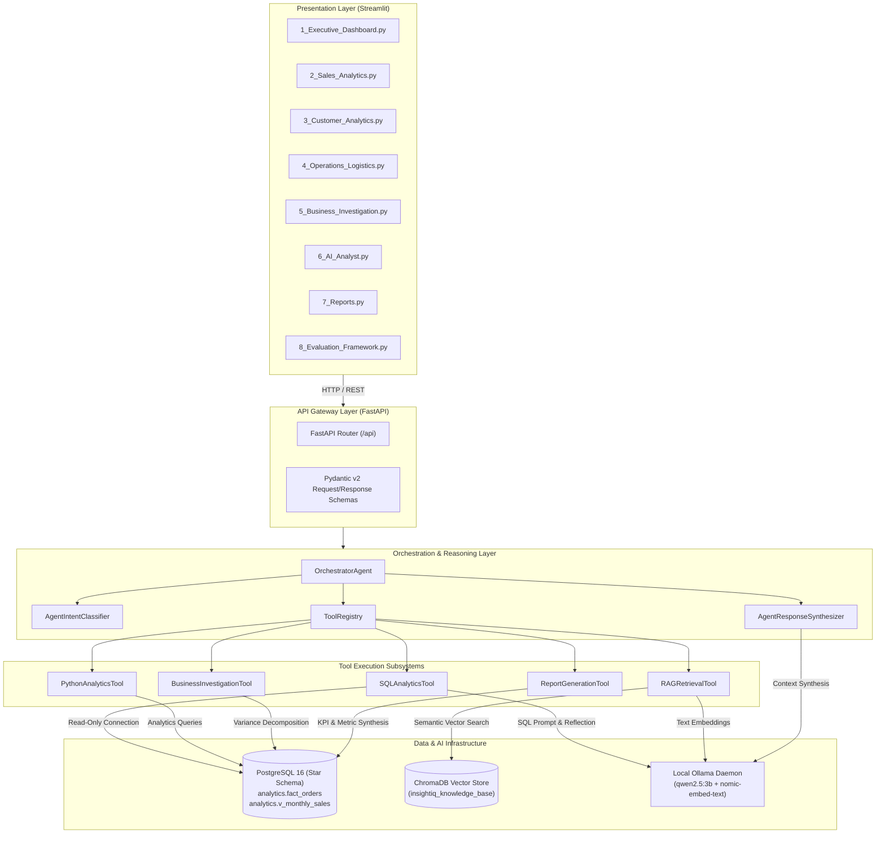
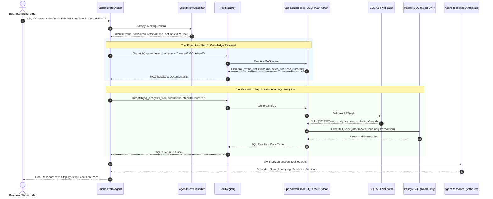

# InsightIQ System Architecture & Security Specification

InsightIQ is an enterprise-grade Agentic Business Intelligence Platform running locally on PostgreSQL 16, ChromaDB, and local Ollama LLMs (`qwen2.5:3b` + `nomic-embed-text`).

---

## 1. High-Level Architecture

The platform follows a layered, decoupled service architecture:



---

## 2. Multi-Agent Orchestrator Execution Flow

When a user submits a question, the single orchestrator agent executes a deterministic step trace:



---

## 3. Database Schema Architecture

PostgreSQL is partitioned into three strictly isolated schemas:

1. **`raw` (Source Ground Truth):**
   - Direct ingestion of 9 Olist CSV files (1,550,922 total records).
   - Ingested with verbatim fidelity without destructive mutations.
2. **`staging` (Cleaning & Surrogate Keys):**
   - Cleaned timestamps, standardized ISO currency columns, and English category translations.
   - Surrogate integer keys for performant join indexing.
3. **`analytics` (Star Schema Marts & Views):**
   - **Dimension Tables:** `dim_date`, `dim_customers`, `dim_products`, `dim_sellers`.
   - **Fact Tables:** `fact_orders` (99,441 rows), `fact_order_items` (112,650 rows), `fact_payments` (103,886 rows), `fact_reviews` (99,224 rows).
   - **Analytical Views:**
     - `v_monthly_sales`: Monthly GMV, freight, revenue, and order counts.
     - `v_category_performance`: Category rankings, item counts, delivered revenue.
     - `v_state_sales_distribution`: Geographic concentration across all 27 Brazilian states.
     - `v_customer_rfm_segments`: Recency, frequency, and monetary customer clustering.
     - `v_seller_performance`: Fulfillment reliability and on-time shipping rates.

---

## 4. Security & Safety Architecture

InsightIQ enforces enterprise-grade security controls preventing data exfiltration, accidental mutations, SQL injections, and generative hallucinations:

### 1. Database Privilege Isolation
- AI Agent operations connect exclusively via the `insightiq_readonly` user:
  ```sql
  GRANT SELECT ON ALL TABLES IN SCHEMA analytics TO insightiq_readonly;
  REVOKE ALL ON SCHEMA raw, staging FROM insightiq_readonly;
  ```
- Any attempt to execute `INSERT`, `UPDATE`, `DELETE`, or `DROP` triggers an immediate PostgreSQL engine permission denial.

### 2. SQL AST Inspection & Security Validator
Before query execution, `SQLValidator` parses the SQL AST:
- **Statement Whitelist:** Strictly permits `SELECT` and `WITH` (CTE) statements.
- **Destructive Operation Blacklist:** Traps and rejects `DROP`, `ALTER`, `TRUNCATE`, `INSERT`, `UPDATE`, `DELETE`, `GRANT`, `REVOKE`, `COPY`, and `EXECUTE`.
- **Schema Boundary Enforcement:** Prohibits direct access to `raw.*` and `staging.*` tables.
- **Automatic Limit Injection:** Automatically appends `LIMIT 500` if absent to prevent runaway memory usage.
- **Statement Timeout:** Every query is executed with `statement_timeout = 10000` (10 seconds max).

### 3. Causal Guardrails in Statistical Inference
- When analyzing correlations (e.g. delivery delay vs customer review scores, $r = -0.27$), the analytical tools enforce strict disclaimers stating that correlation does not establish sole causality.
- Prevents the agent from falsely asserting that operational delays are the exclusive cause of negative customer feedback.

### 4. Lexical Grounding & Anti-Hallucination
- Generated answers are scored against required ground truth facts and numbers.
- If data is absent, the agent is constrained by prompt rules to disclose the limitation rather than invent plausible approximations.
